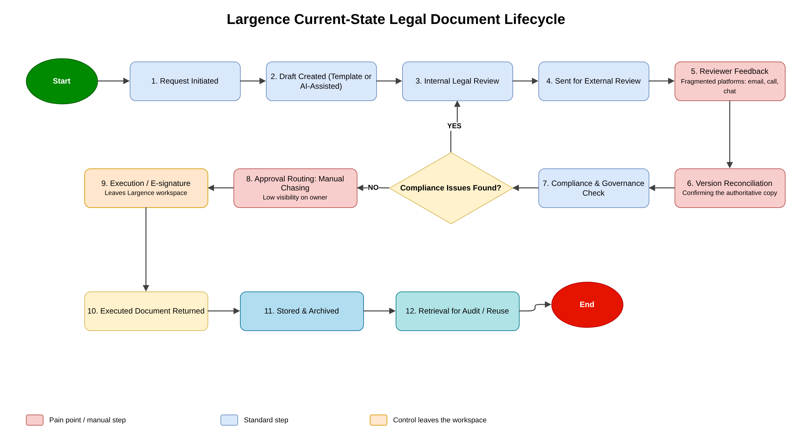
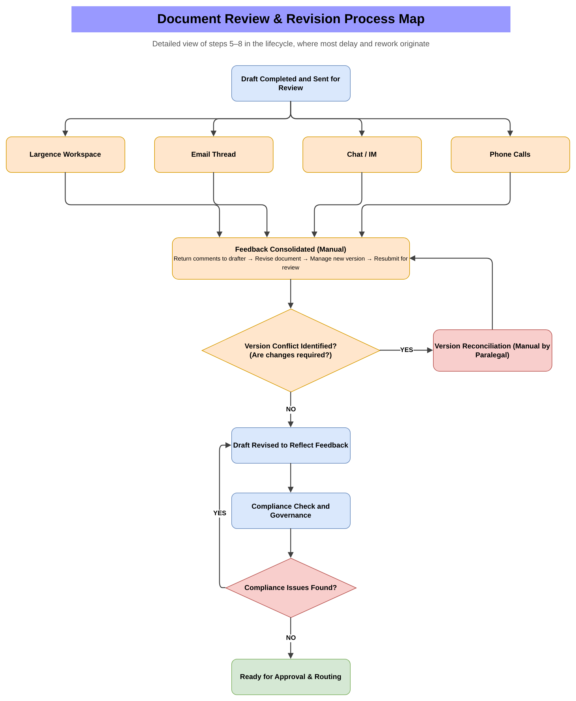
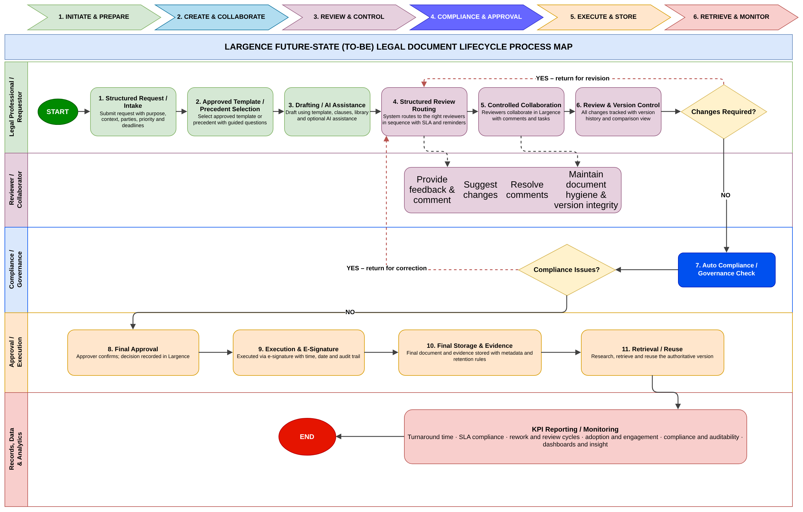

# Largence LegalTech — AI-Assisted Legal Document Lifecycle: Business Analysis & Future-State Recommendations

**Client:** Largence (LegalTech platform)
**Project type:** 2-week / 10-working-day Business Analysis engagement — a team project (2 Project Managers and 4 Business Analysts)
**My role:** Business Analyst on the team; I compiled the final consulting report (Deliverable 9)
**Status note:** The engagement recommends improvements and does not implement software. Several numeric baselines were not available, so the report separates validated qualitative findings from targets that still need data confirmation — no unsupported figures are invented.

## Business context
Largence supports the legal document lifecycle from request and drafting through review, compliance, approval, execution, storage and retrieval. But the end-to-end process is not yet run as one connected, visible, governed workflow. Users move between Largence, Word, email, shared repositories and e-signature tools, which weakens visibility and relies on manual coordination.

## Problem
- **Fragmented workflow** across five disconnected environments
- **Review and approval delays** caused by manual follow-up
- **Version uncertainty** — several edited copies across channels, wrong-version risk and rework
- **Approval evidence gaps** — decisions not always linked to the exact version approved
- **Uneven adoption** of AI, workflow automation and reporting features, and **trust and governance concerns** about AI-assisted legal work
- **Incomplete baselines** for cycle time, rework and compliance

## Approach
- Stakeholder questionnaire and semi-structured interviews across 10 stakeholder groups (lawyers, paralegals, legal operations, product, compliance, customer success, IT, data and analytics, sponsor, users)
- Document analysis, **current-state process mapping**, a detailed **review and revision map** of where delay and rework start, and **root-cause analysis** across 6 categories (people, process, technology, governance, data/measurement, external/client)
- Gap analysis and **24 prioritised requirements** (business, process, document control, collaboration, governance, responsible AI, knowledge, reporting, adoption, integration)
- **Future-state workflow** and operating model across 9 stages, **12 recommendations (R1–R12)**, a **12-measure KPI framework**, a governance and responsible-AI summary, and a **12-month roadmap**
- Benchmark research used only to support gaps already validated at Largence

## Key findings
- The main issue is **control, not capability**: Largence supports much of the lifecycle, but version, approval and evidence control and workflow ownership are inconsistent
- 10 consolidated findings; 7 rated High priority, including version uncertainty, approval evidence gaps, off-platform collaboration and AI trust
- Six interrelated root-cause categories explain the delays, rework and uneven adoption

## Future-state design
A connected lifecycle with clear ownership, status and evidence at every stage: **Request → Draft → Review → Revision → Compliance → Approval → Execution → Final Record → Reporting.** Administrative routing and reminders are automated; **legal judgement, risk acceptance, compliance approval and execution authority stay with qualified humans.**

## Priority recommendations
| ID | Recommendation | Timing |
|---|---|---|
| R1 | Authoritative-version and document-status model | Must / Immediate |
| R2 | Link approval and compliance evidence to the exact document version | Must / Immediate |
| R3 | Define workflow ownership, approval authority and escalation rules | Must / Immediate |
| R4 | Reduce avoidable off-platform handoffs, using existing Largence capability first | Must / Immediate |
| R6 | Formalise responsible-AI controls (human review, verification, traceability) | Must / Immediate |
| R5 | Role-based dashboards and KPI definitions | Must / Near term |
| R11 | Structured final-record and evidence model | Must / Near term |

## KPI framework (baselines to be confirmed)
End-to-end turnaround time · stage waiting time · review/approval cycle count · on-time completion rate · rework/version incident rate · platform-contained workflow rate · advanced-feature adoption · compliance delay rate · approval evidence completeness · audit trail completeness · final document retrieval time · user adoption.
Suggested 6-month review targets, once baselines exist: turnaround −30%, rework/revision cycles −25%, workflow visibility +50%, feature adoption +20%.

## Roadmap
**0–30 days** validate and control → **1–3 months** embed the workflow → **3–6 months** integrate and improve → **6–12 months** optimise and scale.

## Outcome / Impact
A decision-ready consulting package: validated findings, a clear future-state workflow, prioritised recommendations, a measurable KPI framework, governance and responsible-AI controls, a phased roadmap and a visible list of open validation items for the sponsor.

## Skills demonstrated
Stakeholder elicitation (surveys and interviews) · current-state and future-state process mapping · root-cause and gap analysis · requirements writing and prioritisation · KPI design · governance and responsible-AI controls · roadmap and risk management · stakeholder presentation · working in a BA and PM team

## Process diagrams
**Current-state legal document lifecycle**

**Document review and revision — where most delay and rework originate**

**Future-state (TO-BE) lifecycle swimlane**

## Files
- [Largence_Legal_Document_Lifecycle_Final_Consulting_Report.docx](./Largence_Legal_Document_Lifecycle_Final_Consulting_Report.docx) — final consulting report (Deliverable 9)
- [Largence_Legal_Lifecycle_Stakeholder_Presentation.pdf](./Largence_Legal_Lifecycle_Stakeholder_Presentation.pdf) — stakeholder presentation
- **[▶ View the process maps online](https://viewer.diagrams.net/#Uhttps%3A%2F%2Fraw.githubusercontent.com%2FKennystfyn%2Flargence-legal-document-lifecycle-ba%2Fmain%2FLargence_Legal_Document_Lifecycle_Process_Maps.drawio)** — opens in your browser, no download needed
- [Largence_Legal_Document_Lifecycle_Process_Maps.drawio](./Largence_Legal_Document_Lifecycle_Process_Maps.drawio) — editable source (3 pages; open at [app.diagrams.net](https://app.diagrams.net))
